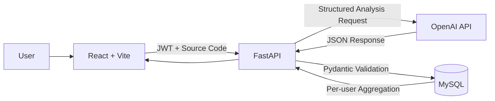
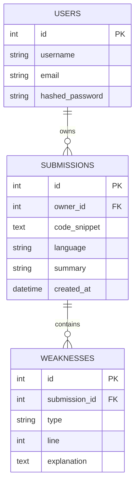
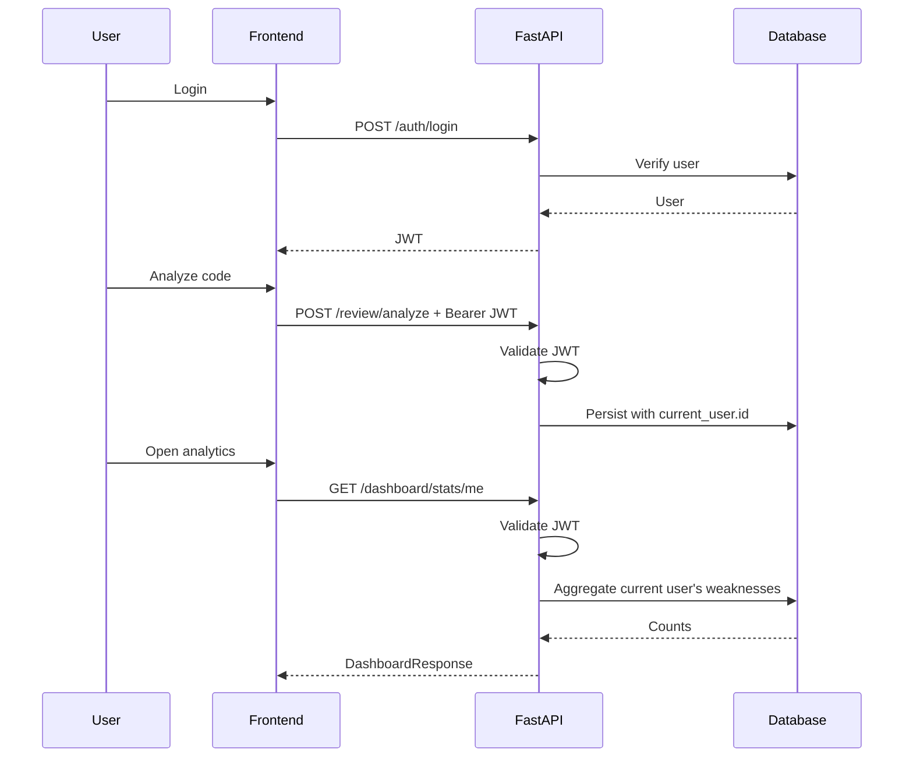

# 🛠️ Technical Overview

Rookie Route is a React + FastAPI application that converts AI-assisted code
reviews into structured per-user learning data.

---

# 🏗️ System Architecture



---

# 📂 Project Structure

```text
app/
├── backend/
│   ├── core/
│   │   ├── config.py
│   │   ├── logging.py
│   │   └── security.py
│   │
│   ├── routers/
│   │   ├── auth.py
│   │   ├── review.py
│   │   └── dashboard.py
│   │
│   ├── services/
│   │   └── analyzer.py
│   │
│   ├── migrations/
│   ├── tests/
│   ├── models.py
│   ├── schemas.py
│   ├── error_types.py
│   ├── database.py
│   ├── back_main.py
│   └── .env.example
│
└── frontend/
    ├── src/
    │   ├── components/
    │   ├── pages/
    │   └── lib/
    └── package.json
```

Real `.env` files are ignored and must not be committed.

---

# 🤖 Structured AI Analysis

The analysis pipeline is:

```text
Source Code
    ↓
OpenAI API
    ↓
JSON Response
    ↓
AIAnalysisResult
    ├─ summary
    └─ AIWeakness[]
          ├─ type
          ├─ line
          └─ explanation
    ↓
Pydantic Validation
    ↓
Database Transaction
```

The model must classify findings using the application's controlled
`ErrorType` taxonomy.

Unsupported categories, malformed JSON, unexpected fields, invalid line
numbers, and oversized responses are rejected before persistence.

---

# 💾 Relational Data Model



Relationships use foreign keys and cascade deletion.

---

# 🔐 Authentication and Ownership

Rookie Route uses JWT Bearer authentication.



The client does not select dashboard ownership using an arbitrary `user_id`.

---

# 📊 Learning Analytics

The dashboard performs database-side aggregation.

Conceptually:

```sql
SELECT weakness_type, COUNT(*)
FROM weaknesses
JOIN submissions
WHERE submissions.owner_id = current_user_id
GROUP BY weakness_type;
```

The API returns:

- total submissions
- count per weakness category

The frontend uses this data to display personal error-pattern statistics.

---

# 🧱 Transaction Boundary

A `Submission` and its related `Weakness` records are persisted in one logical
transaction.

```text
INSERT Submission
      ↓
flush()
      ↓
INSERT Weakness[]
      ↓
commit()
```

If persistence fails:

```text
rollback()
```

This prevents partially saved analysis results.

---

# 🗃️ Database Migration

Schema changes are managed using Alembic rather than application-startup
`create_all()` calls.

The migration suite includes compatibility handling for the legacy ownership
model and regression tests for invalid migration input.

---

# 🧪 Testing

Backend tests cover areas including:

- authentication
- JWT validation
- structured AI response validation
- provider failure mapping
- transaction rollback
- foreign keys and cascade behavior
- migration behavior
- structured logging

GitHub Actions runs regression tests against both SQLite and MySQL.

Frontend CI runs:

```text
npm test
npm run build
```